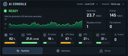

# Local AI Monitor for iCUE

Widget responsive pour le CORSAIR XENEON EDGE. Il regroupe dans une même interface les métriques d'un serveur local `llama.cpp` et les principaux capteurs matériels exposés par iCUE.



## Fonctionnalités

- débit de génération et de traitement du prompt ;
- requêtes actives et file d'attente ;
- charge GPU, VRAM, cache KV, température GPU, CPU et RAM ;
- vues Runtime, Hardware et Errors ;
- mise en page dédiée aux formats S, M, L et XL ;
- numéro de version visible dans l'interface ;
- détection automatique des capteurs avec sélecteurs iCUE manuels en secours ;
- affichage lisible lorsque le serveur local est indisponible.

## Installation

1. Télécharger `Local-AI-Monitor-2.6.0.icuewidget` depuis la release **v2.6.0**.
2. Importer le fichier dans iCUE.
3. Ajouter **Local AI Monitor Responsive** au tableau de bord du XENEON EDGE.
4. Vérifier la présence du badge `v2.6.0` à côté de **AI CONSOLE**.

Le widget utilise par défaut `http://127.0.0.1:18091`. Cette adresse, le modèle, le libellé du backend et les capteurs peuvent être modifiés dans les propriétés du widget.

Le serveur attendu expose les routes compatibles `llama.cpp` suivantes : `/health`, `/metrics`, `/slots` et `/props`.

## Formats XENEON EDGE

| Format | Dimensions | Présentation |
| --- | --- | --- |
| S | 840 × 344 | GPU, VRAM, cache KV et température GPU dans Runtime ; CPU, RAM et erreurs dans les onglets dédiés |
| M | 840 × 696 | Toutes les métriques, avec une grille matérielle 4 + 3 |
| L | 1688 × 696 | Tableau de bord complet et typographie agrandie |
| XL | 2536 × 696 | Tableau de bord complet et typographie agrandie |

## Validation locale

Le test de fumée ne dépend d'aucun paquet npm :

```powershell
node .\tests\runtime-smoke.cjs
```

Il vérifie notamment le bootstrap du widget, la température GPU, les charges GPU/CPU/RAM, la VRAM et la connexion unique au plugin de capteurs.

## Construction du paquet

La construction nécessite l'outil officiel `icuewidget` dans le `PATH` :

```powershell
powershell -NoProfile -ExecutionPolicy Bypass -File .\build.ps1
```

Le script valide le manifeste, les traductions, les ressources, la syntaxe JavaScript et l'archive finale avant de produire le fichier `.icuewidget`.

## Retour arrière

La branche 2.6 utilise l'identifiant iCUE `fr.pierrechevalier.localaimonitor.responsive`. Elle peut donc rester installée à côté de l'ancienne ligne 2.2. Pour revenir en arrière, retirer la 2.6.0 du tableau de bord et réactiver l'ancienne version.

