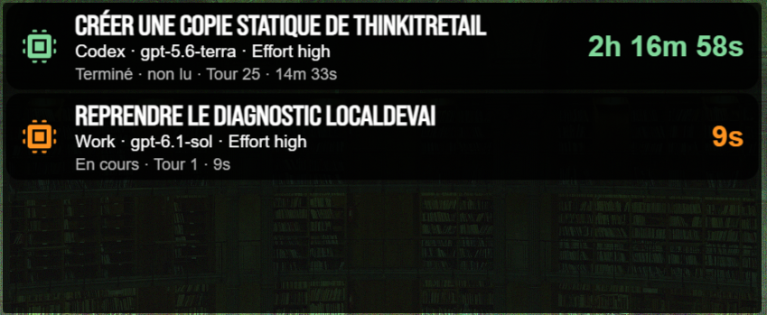

# Codex Task List pour iCUE

Codex Task List affiche sur le CORSAIR XENEON EDGE les tâches en cours et les résultats terminés qui restent à lire. Il s’appuie sur les données disponibles dans l’application de bureau sous Windows.



## Lire le widget

Chaque ligne affiche le titre de la tâche, son origine (Codex, Work, ChatGPT ou Autre), puis le modèle et l’effort de raisonnement lorsque ces informations sont disponibles. Le résultat terminé reste visible en vert tant que l’application le signale comme non lu.

- **Ligne grise** — activité ou état, numéro du tour et durée de ce tour. La numérotation repart à 1 à chaque nouvelle demande utilisateur.
- **Chrono à droite** — temps cumulé de l’objectif lorsqu’il est disponible. Sans objectif, il additionne les durées de traitement depuis la dernière demande utilisateur. Les deux chronos peuvent coïncider au premier tour.
- **Ordre de la liste** — les nouvelles tâches s’ajoutent en bas. Les mises à jour des chronos conservent l’ordre des lignes et la position de défilement.

Une tâche lancée dans le navigateur, y compris depuis un autre appareil, apparaît dès que son état remonte dans l’application de bureau. Le modèle, l’effort et l’état de lecture suivent les informations que cette application reçoit.

## Installation locale

Il faut un PC sous Windows avec l’application de bureau, Node.js avec le module intégré `node:sqlite`, iCUE 5.47 ou ultérieur et un XENEON EDGE. Ces étapes supposent que vous disposez du paquet local du widget et des scripts du service de liaison.

1. Depuis le dossier du projet, exécutez `.\bridge\install-bridge.ps1` dans PowerShell. Le service de liaison démarre et se relance à l’ouverture de session Windows.
2. Importez `Codex-Task-List-1.2.4.icuewidget` dans iCUE, puis ajoutez **Liste des tâches Codex** au tableau de bord du XENEON EDGE.
3. Conservez l’URL par défaut, `http://127.0.0.1:18092`.

Le service de liaison lit les données de l’application en lecture seule et écoute sur la boucle locale. Si le widget indique **Service indisponible**, vérifiez la réponse du service dans PowerShell.

```powershell
Invoke-RestMethod http://127.0.0.1:18092/health
```

La mise en page est adaptée du widget **Liste des capteurs** de Corsair. Cette page présente le widget et son installation avec un paquet local.
